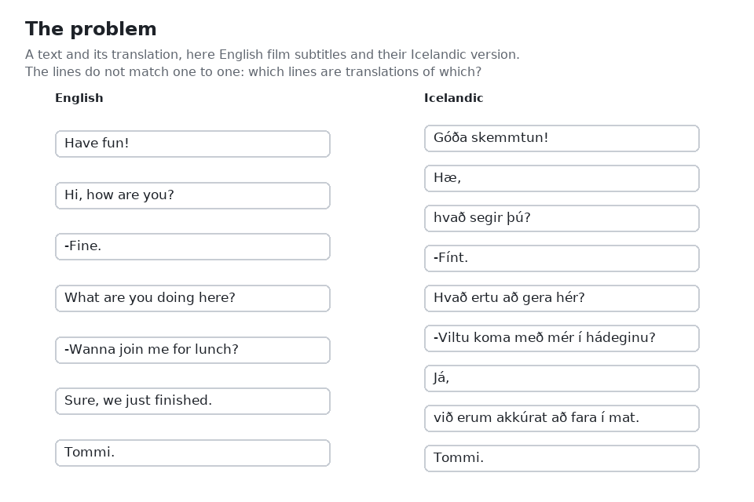

# SentAlign 2.0

Released 2026-11-15.

SentAlign is a sentence aligner. Given a text and its translation, it finds which sentences of the one are
translations of which sentences of the other. The sentence pairs it produces are what parallel corpora are made of:
the training data of machine translation systems and the material of translation studies.

**The problem.** Translators do not work sentence by sentence. They split a long sentence in two, join two short
ones, leave a sentence out or add one. After the first such place, the tenth sentence of the original is no longer
the tenth sentence of the translation, and a long document has many such places. SentAlign compares the meaning of
sentences across languages with [LaBSE](https://aclanthology.org/2022.acl-long.62/), a multilingual sentence
encoder, and searches for the best alignment of the whole document at once:



*English film subtitles and their Icelandic translation, from the English-Icelandic evaluation set; the scores are
LaBSE's. Two English lines are each translated by two Icelandic ones, and SentAlign finds both. More in
[How it works](#how-it-works).*

The method is described in the paper [SentAlign: Accurate and Scalable Sentence Alignment](https://aclanthology.org/2023.emnlp-demo.22/)
(EMNLP 2023, System Demonstrations).

## SentAlign 2.0

This is release 2.0. It can be installed from PyPI with `pip install sentalign` or from this repository, and it gives
the same alignments as the version of the paper when asked to (`--compat paper-2023`). The code of the paper is the
tag [`v1.0-paper`](https://github.com/steinst/SentAlign/tree/v1.0-paper).

**New in version 2:**

* **Easy to install and run**: `pip install sentalign`, then the `sentalign` command, for one pair of files or a
  whole folder of documents; or `import sentalign` and align lists of sentences in Python.
* **Faster**: the path search is several hundred times faster, so books of 10,000 x 10,000 sentences are aligned in
  one piece; longer ones are first cut at sentence pairs that certainly belong together. On a GPU, half precision
  makes the encoding about three times faster.
* **More accurate defaults**: the faults found in version 1 are fixed (a sentence could end up in two links, blank
  lines were mishandled, cutting long documents could crash). `--compat paper-2023` still reproduces version 1 and
  the paper's numbers exactly.
* **Runs without a GPU**: the CPU is used when no GPU is found (much slower, but it works out of the box).
* **Other sentence encoders**: any Hugging Face sentence encoder by its name, LASER 2 and 3, and short names for
  common ones (`--encoder minilm`, `mpnet`, `laser2`, `laser3`).
* **Other alignment methods** to compare with: the search of Vecalign, a chain search after ChainAlign and the
  length-based Gale-Church method (`--pathfinder`), a second link reward (`--reward squared-cosine`) and a length
  prior. Your own scorer, search or anchor method can be plugged in
  ([docs/extending.md](https://github.com/steinst/SentAlign/blob/master/docs/extending.md)).
* **Practical for large jobs**: documents already aligned are skipped, a stopped run can be started again, the
  vectors can be cached (`--embedding-cache`), every document gets a record of its run (settings, model, timings),
  and the exit code tells whether everything went well.
* **What to cite**: after each run SentAlign lists the publications behind the settings it used (`--bibtex` for the
  BibTeX entries).
* **Tools for evaluation** (in this repository): scripts that compute precision and recall against a gold standard,
  also for book-length texts, and a web tool for annotating gold standards.

All changes are listed in [CHANGELOG.md](https://github.com/steinst/SentAlign/blob/master/CHANGELOG.md).

## Installation

From PyPI:
```bash
pip install sentalign
pip install "sentalign[rust]"      # optional: faster on very long documents (uses several processor cores)
```
LaBSE (about 1.9 GB) is downloaded on the first run. SentAlign uses an NVIDIA GPU when PyTorch finds one, and the
CPU otherwise. On Windows the PyTorch of PyPI has no GPU support: for a GPU, first install PyTorch as
[pytorch.org](https://pytorch.org/get-started/locally/) shows for your system, then `pip install sentalign`.

From this repository:
```bash
git clone https://github.com/steinst/SentAlign.git
cd SentAlign
pip install .                      # or, for development: pip install -e ".[test]"
```
This compiles the fast parts of SentAlign; without a C compiler it still installs, but aligns much more slowly.
See [CONTRIBUTING.md](https://github.com/steinst/SentAlign/blob/master/CONTRIBUTING.md) for a development
environment and the tests.

## Usage

**Two files.** Each file has one sentence per line:
```bash
sentalign english.txt icelandic.txt -o output -sl eng -tl isl
```
The alignment is in `output/english.txt.path`, one link per line: the source sentence numbers, the target sentence
numbers and the score. Sentences are numbered from 0; an empty side is a sentence without a counterpart. For the
lines of the figure above (and one more English line, which the Icelandic file lacks):
```
[0]:[0]:0.8871294
[1]:[1,2]:0.67091334
[2]:[3]:0.965598
[3]:[4]:0.95324266
[4]:[5]:0.93558437
[5]:[6,7]:0.60770327
[6]:[8]:0.9999995
[7]:[]:0
```
and the sentence pairs in `output/english.txt.aligned`, tab-separated: source text, target text, score.

**A folder of documents.** The documents have the same names in both languages and are kept in sub-folders named
by language code:
```
/path/to/files/eng/file1.txt
/path/to/files/eng/file2.txt
/path/to/files/isl/file1.txt
/path/to/files/isl/file2.txt
```
To align all of them:
```bash
sentalign -dir /path/to/files -sl eng -tl isl
```
The output goes to `/path/to/files/output` (`-out` to choose). Documents that are already aligned are skipped
(`--overwrite` aligns them again), `-f file1.txt file2.txt` aligns only those, and `--list-files` shows what would be
aligned.

**Other output.** Next to each `.path` file, `<name>.json` records the run: settings, model, timings and versions.
The exit code is 0 when every document was aligned, 1 when any failed and 2 for a usage error. `-q` shows warnings
only, `-v` more detail. `sentalign --help` lists every option; they are also described under [Options](#options).

**From Python:**
```python
import sentalign

aligner = sentalign.SentAlign()                         # the model is loaded once
result = aligner.align(english_sentences, icelandic_sentences)

for link in result.aligned():                           # links with sentences on both sides
    print(link.src, link.trg, round(link.score, 3))     # sentence numbers, e.g. (1,) (1, 2) 0.671
result.pairs()                                          # [(source text, target text, score), ...]
result.to_path_lines()                                  # the rows of the .path file

results = aligner.align_many(list_of_pairs)             # many documents at once
aligner.citations(bibtex=True)                          # what to cite for these settings
```
The options are those of the command line with Python names (`score_cutoff`, `encoder`, `compat`, `device`, ...).

**Version 1 commands.** `python3 sentAlign.py -dir ...` from the repository still works, and so does
`sentalign-files -dir /path/to/files --source-language eng` (the old `files2align.py`).

## How it works
1. **Spans.** Every sentence, and every run of up to four consecutive sentences, is a *span*.
2. **Scores.** A scorer rates each source span against each target span; by default the cosine similarity of LaBSE
   embeddings.
3. **Path search.** The best path through the grid of "the first a source and b target sentences are done" is
   found by dynamic programming. A step skips one sentence (reward: the score cutoff, 0.4) or links `ks` source and
   `kt` target sentences (1 to 4 each) for the reward

       (ks + kt) * (score - length penalty) ** (ks + kt - 1)

   if the score is at least the cutoff. A 1-1 link earns 2 x score, a 1-2 link 3 x score^2, and so on: the power
   punishes long merges, so 1-1 links win unless a merge is clearly better. The length penalty is `-wordpen` for
   each word above `-penwords` on each side.
4. **Re-evaluation.** Each link with several sentences on a side is split into its best-scoring parts, and links
   absorb unaligned neighbours when that raises their score. A sentence is never in two links.
5. **Anchors.** A document too large to solve in one piece (more than 100 million nodes, about 10,000 x 10,000
   sentences) is first cut at sentence pairs that certainly belong together.

Scorer, path search and anchoring can each be replaced: see [docs/extending.md](https://github.com/steinst/SentAlign/blob/master/docs/extending.md).

## Reproducing the paper

The 2023 paper evaluates SentAlign on two evaluation sets, included in [`eval_data/`](https://github.com/steinst/SentAlign/blob/master/eval_data/README.md): the
German-French set from the Text+Berg corpus published with Bleualign, and an English-Icelandic set from the ParIce
corpus. The runs below were made from the repository on a GPU (each takes well under a minute once LaBSE is downloaded).

`--compat paper-2023` reproduces SentAlign 1.0, faults included; its output is byte-identical to that of tag
`v1.0-paper` (on the CPU the last digits of the scores can differ). `evaluate.py --lax-recall paper-2023` computes
lax recall as the script of the paper did.

**German-French, as in the paper:**
```bash
sentalign -dir eval_data/bleualign -sl deu -tl fra --compat paper-2023 -out output-paper
python3 evaluation/evaluate.py --lax-recall paper-2023 \
    -t eval_data/bleualign/output-paper/test*.txt.path -g eval_data/bleualign/gold/test*.txt
```
```
 ---------------------------------
|             |  Strict |    Lax  |
| Precision   |   0.935 |   0.998 |
| Recall      |   0.929 |   0.933 |
| F1          |   0.932 |   0.964 |
 ---------------------------------
```

**English-Icelandic, as in the paper:**
```bash
sentalign -dir eval_data/parice -sl eng -tl isl --compat paper-2023 -out output-paper
python3 evaluation/evaluate.py --lax-recall paper-2023 \
    -t eval_data/parice/output-paper/*.path -g eval_data/parice/gold/*.txt
```
```
 ---------------------------------
|             |  Strict |    Lax  |
| Precision   |   0.948 |   0.985 |
| Recall      |   0.953 |   0.955 |
| F1          |   0.951 |   0.970 |
 ---------------------------------
```

**Lax recall.** By default `evaluate.py` counts a gold alignment as found when a system alignment overlaps it on
both sides, as the evaluations of Bleualign and Vecalign do. The script of the paper counted a gold alignment that
was only found under this lax condition as missed, which gave lower lax recall and F1. Strict scores and lax
precision are the same in both. Without `--lax-recall paper-2023` the paper-2023 output above gives
lax recall 0.980 and lax F1 0.989 (German-French), 0.988 and 0.986 (English-Icelandic).

**SentAlign 2 (the default mode):**
```bash
sentalign -dir eval_data/bleualign -sl deu -tl fra
python3 evaluation/evaluate.py \
    -t eval_data/bleualign/output/test*.txt.path -g eval_data/bleualign/gold/test*.txt
sentalign -dir eval_data/parice -sl eng -tl isl
python3 evaluation/evaluate.py -t eval_data/parice/output/*.path -g eval_data/parice/gold/*.txt
```
| | Strict P | Strict R | Strict F1 | Lax P | Lax R | Lax F1 |
|---|---|---|---|---|---|---|
| German-French | 0.934 | 0.928 | 0.931 | 0.998 | 0.980 | 0.989 |
| English-Icelandic | 0.948 | 0.953 | 0.951 | 0.985 | 0.988 | 0.986 |

On German-French two links differ from the paper-2023 mode, the two in which version 1 put a sentence that was
already in the link before it (target 99 of `test0`, source 4 and target 4 of `test6`); version 2 never puts a
sentence in two links. This costs 0.001 in strict precision and recall. On English-Icelandic the links are the same
in both modes. The 0.932 of the paper is the paper-2023 mode.

`evaluate.py` also prints the papers to cite for the evaluation sets (`--bibtex` for the entries).

## Options

`sentalign --help` lists them too. Where version 2 and `--compat paper-2023` (version 1) have different defaults,
both are given.

### Input and output

| Option | Short | Value | Default | What it does |
|---|---|---|---|---|
| `SRC_FILE TRG_FILE` | | two files | | align one pair of files (needs `-o`) instead of a corpus folder |
| `--output` | `-o` | folder | | output folder of the `SRC_FILE TRG_FILE` form |
| `--corpus-folder` | `-dir` | folder | | corpus folder with one sub-folder per language |
| `--source-language` | `-sl` | code | `eng` with `-dir` | source language: its sub-folder, and the language given to an encoder that needs it |
| `--target-language` | `-tl` | code | `isl` with `-dir` | target language |
| `--filename` | `-f` | names | all files | align only these files of the corpus folder |
| `--output-folder` | `-out` | folder | `output` | output folder, relative to the corpus folder (an absolute path is used as it is) |
| `--overwrite` | | | off | align files again that already have output |
| `--list-files` | | | off | print the files that would be aligned and exit |

### Aligner settings

| Option | Short | Value | Default | What it does |
|---|---|---|---|---|
| `--compat` | | `none`, `paper-2023` | `none` | `none`: SentAlign 2. `paper-2023`: reproduce SentAlign 1.0 and the 2023 paper (its arithmetic, post-processing and large-file anchors, faults included); sets the paper-2023 defaults of this table |
| `--max-concatenations` | `-concats` | 1-15 | 4 | most sentences joined on one side of a link |
| `--free-concatenations` | `-freejoins` | number | 2 | sentences of a link (both sides) whose score is not raised to a power: the reward is `(ks + kt) * score ** (ks + kt - freejoins + 1)` |
| `--score-cutoff` | `-cutoff` | score | 0.4 (0.3 with `--reward squared-cosine`) | lowest score of a link; also the reward for skipping a sentence. Tuned for LaBSE: other encoders need their own |
| `--minimum-length-words` | `-minwords` | words | 1 | fewest words per side of a link |
| `--maximum-length-words` | `-maxwords` | words | 110 | most words per side of a link |
| `--penalty-after-words` | `-penwords` | words | 80 | words per side before a length penalty applies |
| `--penalty-per-word` | `-wordpen` | number | 0.01 | penalty per word above `-penwords` |
| `--anchoring-delimiter` | `-anchor` | nodes | 100000000 (paper-2023: 4000000) | a document with more nodes (source x target sentences) is cut at anchors |
| `--maximum-length-gale-church` | `-maxgc` | sentences | 10000 | paper-2023 only: a file with more sentences on a side gets the greedy anchors of version 1 |

### Running

| Option | Short | Value | Default | What it does |
|---|---|---|---|---|
| `--proc-device` | `-device` | `auto`, `cuda`, `cuda:1`, `cpu` | `auto` | PyTorch device for the encoder. `auto`: `cuda` when PyTorch finds an NVIDIA GPU with CUDA, else `cpu`. `cuda` without such a GPU is an error (exit code 2) |
| `--num-proc` | `-proc` | number | 8 | threads for the path search of segments; cores per document with `--path-backend rust` |
| `--quiet` | `-q` | | off | log only warnings and errors |
| `--verbose` | `-v` | | off | log details (stages inside the anchoring) |
| `--bibtex` | | | off | also print the BibTeX entries of the publications to cite (the list is always printed) |
| `--version` | | | | print the version and exit |
| `--help` | `-h` | | | print the options and exit |

### Scoring

| Option | Short | Value | Default | What it does |
|---|---|---|---|---|
| `--encoder` | | name, Hugging Face id or folder | `setu4993/LaBSE` | sentence encoder: a short name (`labse`, `bge-m3`, `minilm`, `mpnet`, `laser2`, `laser3`), a Hugging Face model id or a local folder (e.g. a fine-tuned LaBSE) |
| `--pooling` | | `pooler`, `cls`, `mean` | `pooler` | sentence vector from the model: LaBSE uses pooler, most sentence-transformers models mean (the short names set it) |
| `--model-revision` | | revision | latest | model revision on the Hugging Face hub (tag, branch or commit) |
| `--max-tokens` | | tokens | 512 | truncation length |
| `--encode-batch-size` | | texts | 128 | texts per encoder batch; halved automatically when the GPU runs out of memory |
| `--batch-order` | | `file`, `length` | `length` (paper-2023: `file`) | `length`: batches sorted by length, less padding; `file`: in file order as version 1 |
| `--batch-texts` | | texts | 200000 (paper-2023: 0) | encode many small files together, up to this many texts per group; 0: one file at a time |
| `--half` / `--no-half` | | | on when the device is `cuda` (paper-2023 and CPU: off) | encoder in half precision: about 3 times faster, same alignments on the evaluation sets; `--no-half` gives float32 |
| `--embedding-cache` | | folder | none | keep the vectors and reuse them when the same text is aligned again |
| `--trust-remote-code` | | | off | allow a model that comes with its own code (it is downloaded and executed: only for a model you trust) |
| `--scorer` | | name | `embedding` | scorer; more through the entry-point group `sentalign.scorers` |
| `--encoder-kind` | | name | `hf` | encoder implementation; more through the entry-point group `sentalign.encoders` |

With `--compat paper-2023` the scoring settings must stay at their defaults to give the results of version 1; a run
that changes them says so in its `.json` record.

**Other encoders.** The score cutoff and the length penalties were tuned for LaBSE. In our evaluation MiniLM and
mpnet needed cutoffs of 0.05-0.25. `laser2` (one BiLSTM for about 100 languages) and `laser3` (a Transformer per
language; a language without one uses LASER 2) need `pip install laser_encoders`; they depend on the language, taken
from `-sl` / `-tl` (`isl`, `is` or `isl_Latn`). For German, French, English and Icelandic `laser3` is the LASER 2
model, since LASER 3 models exist only for languages that LASER 2 covers badly. The best cutoff of `laser2` was
0.4-0.5 on both evaluation sets.

### Anchoring (documents above the node limit)

| Option | Short | Value | Default | What it does |
|---|---|---|---|---|
| `--anchors` | | strategy | `auto` | `auto` (`mutual-best`; paper-2023: what version 1 did), `none`, `mutual-best`, `gale-church`, `legacy-greedy`, `file:PATH`; more through the entry-point group `sentalign.anchorers` |
| `--anchor-margin` | | score | 0.05 | an anchor pair must score this much above the second-best match of either sentence |
| `--anchor-min-words` | | words | 4 | shortest sentence that can be an anchor |
| `--max-segment-nodes` | | nodes | 4000000000 | largest segment that is solved (a segment without an anchor, or a whole document that is not cut); above it the file fails |

Below the node limit the whole document is solved at once, which is always the safer choice: a wrong anchor loses
everything between its true and its false position.

* `mutual-best`: a pair is a candidate only if each sentence is the other's best match in the whole document,
  clearly ahead of the second best, and neither is very short. Candidates that are out of order with the others, or
  that stand alone, are dropped; of the rest only as many are used as are needed, the most confident first. A
  segment without a sure anchor is solved whole.
* `gale-church`: candidates are the 1-1 links of the Gale-Church alignment that the scorer confirms (the method
  described in the 2023 paper).
* `file:PATH`: your own anchors (for instance confirmed chapter starts), one `source<TAB>target` sentence number per
  line.
* `legacy-greedy`: the large-file anchoring of SentAlign 1.0, faults included, for regenerating old results.
* `none`: never cut.

### Path search

| Option | Short | Value | Default | What it does |
|---|---|---|---|---|
| `--pathfinder` | | name | `sentalign-dp` | path search: `sentalign-dp`, `vecalign`, `chain`, `galechurch` (all but `sentalign-dp` need `--compat none`); more through the entry-point group `sentalign.pathfinders` |
| `--pathfinder-opt` | | `NAME=VALUE ...` | | settings of the chosen path finder (tables below) |
| `--reward` | | `sentalign`, `squared-cosine` | `sentalign` | link reward of `sentalign-dp`: the reward of [How it works](#how-it-works), or `score^2` with free skipping (the link weight of ChainAlign); needs `--compat none` |
| `--length-prior` | | | off | with `--reward squared-cosine`: multiply the reward by the length-ratio prior of ChainAlign (for complete translations only) |
| `--path-backend` | | `auto`, `cython`, `rust`, `python`, `legacy` | `auto` | kernel of `sentalign-dp`, all with the same results: `auto`/`cython` compiled; `rust` the same kernel on several cores (`-proc`), needs `sentalign[rust]`; `python` the readable reference (slow); `legacy` the 2023 code itself (paper-2023 only) |

**The Rust kernel** helps for very long documents: on 16 cores the path search of a 22,000 x 24,000-sentence book
takes 20 s instead of 31 s solved whole, and 3.1 s instead of 3.5 s with the default anchors. For ordinary documents
the default kernel is as fast, and most of the time goes into encoding anyway.

**`--reward squared-cosine`** keeps everything of SentAlign (exact search, anchors, kernels, post-processing) and
changes only what a link is worth. On the two evaluation sets it gives strict F1 0.940 / 0.953 (0.942 / 0.956 with
`--length-prior`) against 0.931 / 0.951 for the default reward; the German-French difference is significant over
documents, the English-Icelandic one is not, and the cutoff of 0.3 comes from the ChainAlign paper, which chose it
partly on the German-French set. It is not the default.

`sentalign-dp` and `galechurch` have no `--pathfinder-opt` settings.

**`--pathfinder vecalign`** runs the search of Vecalign (Thompson and Koehn 2019) on the vectors of the SentAlign
scorer. The search code is Vecalign's own, included in this package (Copyright 2019 Brian Thompson, Apache License
2.0; `pathfinding/_vecalign.py`, `_vecalign_core.pyx`). With the same vectors each document gets the alignment the
`vecalign` command gives it as the first document of a run (tested on both evaluation sets); the random generator is
seeded per document, where the original seeds once per run. Anchors, the score cutoff and the SentAlign
post-processing are not used; the score column is the cosine of each link.

| Setting | Default | What it does |
|---|---|---|
| `alignment_max_size` | 4 | links of at most x + y sentences (5 is the most that spans of four sentences allow) |
| `del_percentile_frac` | 0.2 | deletion cost: this percentile of the costs of random sentence pairs |
| `search_buffer_size` | 5 | half width of the search corridor, on top of half the largest link |
| `max_size_full_dp` | 300 | a document is halved until n x m is at most this squared |
| `costs_sample_size` | 20000 | random sentence pairs sampled for the deletion cost |
| `num_samps_for_norm` | 100 | samples for the normalisation of the costs |
| `seed` | 42 | random seed, per document |

**`--pathfinder chain`** is a re-implementation after ChainAlign (Goldner and Gramazio 2026), written from the
paper: candidate links (the best per source span and link type, inside a diagonal band), the maximum-weight set of
candidates that do not cross (weight `score^2 x length-ratio prior`), then a small dynamic programme in the gaps. On
the German-French evaluation set it gives the paper's strict F1 for all four rows of its ablation table (0.915,
0.930, 0.940, 0.941). For abridged or partial translations use `--pathfinder-opt band=0 skip_cost=-0.1`, as the
paper does for text that is not parallel throughout.

| Setting | Default | What it does |
|---|---|---|
| `threshold` | 0.3 | lowest score of a candidate link |
| `band` | 0.15 | diagonal band, as a fraction of the document; 0 = none |
| `top_k` | 10 | candidates kept per source span and link type |
| `max_size` | 5 | link types with k + l at most this, in the gaps |
| `seed_max_size` | 5 | the same among the candidates (3 = the paper's base configuration) |
| `cos_power` | 2 | exponent of the score in the link weight |
| `length_prior` | true | multiply the link weight by the length-ratio prior |
| `skip_cost` | -0.5 | per skipped sentence in the gaps |
| `margin` | true | gap score = score minus the mean of its row and column means; false: the plain score |
| `extend` | true | align the gaps; false: the chain only |
| `max_gap_cells` | 10000000 | a gap between chained links with more node pairs than this is left unaligned (with a warning) |

**`--pathfinder galechurch`** is the length-based [Gale-Church](https://aclanthology.org/J93-1004) alignment of the
`galechurch` package alone, as a baseline: strict F1 0.69 on the German-French and 0.79 on the English-Icelandic
evaluation set. Its links are scored with the scorer; there is no post-processing. Blank lines are left out of its
input and the sentence numbers stay those of the file.

`--compat none` uses the corrected post-processing (no sentence in two links, links of consecutive sentences only);
`--compat paper-2023` reproduces SentAlign 1.0, including three sentences of the German-French evaluation set that
it aligned twice.

## What to cite

SentAlign prints, after every run, the publications to cite for that run: SentAlign itself and each method of other
authors that the run used. `--bibtex` adds the BibTeX entries; from Python, `SentAlign(...).citations(bibtex=True)`.
The evaluation script does the same for the evaluation sets. All entries are listed under
[Publications](#publications). A paper on SentAlign 2 is in preparation; until it is published the program prints a
placeholder for it next to the 2023 paper.

## Licence

Copyright 2023-2026 Steinþór Steingrímsson

SentAlign is released under the [Apache License, Version 2.0](https://github.com/steinst/SentAlign/blob/master/LICENSE). It includes the search code of
[Vecalign](https://github.com/thompsonb/vecalign) (Copyright 2019 Brian Thompson, Apache License 2.0); see `NOTICE`.
The German-French evaluation data keeps its own licence (GNU GPL 2) and the English-Icelandic set is CC BY 4.0; see
[eval_data/README.md](https://github.com/steinst/SentAlign/blob/master/eval_data/README.md).

## Acknowledgements

Thanks to Abdulrahman Almajdalawi for the PyPI name transfer.

## Publications

SentAlign prints the entries that apply to a run (see [What to cite](#what-to-cite)). A paper on SentAlign 2 is
in preparation; this list will name it when it is published.

**Steingrímsson, S., Loftsson, H. and Way, A. (2023). SentAlign: Accurate and Scalable Sentence Alignment. EMNLP 2023: System Demonstrations.**

Cite always when you use SentAlign (both modes).

```bibtex
@inproceedings{sentalign-2023,
    title = {{SentAlign: Accurate and Scalable Sentence Alignment}},
    author = "Steingr{\'i}msson, Stein{\th}{\'o}r and Loftsson, Hrafn and Way, Andy",
    booktitle = "Proceedings of the 2023 Conference on Empirical Methods in Natural Language Processing: System Demonstrations",
    month = dec,
    year = "2023",
    address = "Singapore",
    publisher = "Association for Computational Linguistics",
    pages = "256--263",
    doi = "10.18653/v1/2023.emnlp-demo.22",
    url = "https://aclanthology.org/2023.emnlp-demo.22/",
}
```

**Feng, F., Yang, Y., Cer, D., Arivazhagan, N. and Wang, W. (2022). Language-agnostic BERT Sentence Embedding. ACL 2022.**

Cite with the default encoder (LaBSE, `--encoder labse`), and for the 2023 results.

```bibtex
@inproceedings{feng-etal-2022-language,
    title = "Language-agnostic {BERT} Sentence Embedding",
    author = "Feng, Fangxiaoyu and Yang, Yinfei and Cer, Daniel and Arivazhagan, Naveen and Wang, Wei",
    booktitle = "Proceedings of the 60th Annual Meeting of the Association for Computational Linguistics (Volume 1: Long Papers)",
    year = "2022",
    address = "Dublin, Ireland",
    publisher = "Association for Computational Linguistics",
    pages = "878--891",
}
```

**Thompson, B. and Koehn, P. (2019). Vecalign: Improved Sentence Alignment in Linear Time and Space. EMNLP-IJCNLP 2019.**

Cite with `--pathfinder vecalign` (its search code is included in SentAlign).

```bibtex
@inproceedings{thompson-koehn-2019-vecalign,
    title = "{V}ecalign: Improved Sentence Alignment in Linear Time and Space",
    author = "Thompson, Brian and Koehn, Philipp",
    booktitle = "Proceedings of the 2019 Conference on Empirical Methods in Natural Language Processing and the 9th International Joint Conference on Natural Language Processing (EMNLP-IJCNLP)",
    year = "2019",
    address = "Hong Kong, China",
    publisher = "Association for Computational Linguistics",
    pages = "1342--1348",
}
```

**Goldner, O. N. and Gramazio, C. C. (2026). ChainAlign: Cross-Lingual Sentence Alignment via Sparse Co-linear Chaining. WMT 2026.**

Cite with `--pathfinder chain` (a re-implementation after this paper) and with `--reward squared-cosine` (its link weight and length prior).

```bibtex
@inproceedings{goldner-gramazio-2026-chainalign,
    title = "{C}hain{A}lign: Cross-Lingual Sentence Alignment via Sparse Co-linear Chaining",
    author = "Goldner, Owen N. and Gramazio, Connor C.",
    booktitle = "Proceedings of the Eleventh Conference on Machine Translation",
    year = "2026",
    publisher = "Association for Computational Linguistics",
    pages = "183--198",
}
```

**Gale, W. A. and Church, K. W. (1993). A Program for Aligning Sentences in Bilingual Corpora. Computational Linguistics 19(1).**

Cite with `--pathfinder galechurch` and `--anchors gale-church`.

```bibtex
@article{gale-church-1993-program,
    title = "A Program for Aligning Sentences in Bilingual Corpora",
    author = "Gale, William A. and Church, Kenneth W.",
    journal = "Computational Linguistics",
    volume = "19",
    number = "1",
    year = "1993",
    pages = "75--102",
}
```

**Artetxe, M. and Schwenk, H. (2019). Massively Multilingual Sentence Embeddings for Zero-Shot Cross-Lingual Transfer and Beyond. TACL 7.**

Cite with `--encoder laser2` or `laser3`.

```bibtex
@article{artetxe-schwenk-2019-massively,
    title = "Massively Multilingual Sentence Embeddings for Zero-Shot Cross-Lingual Transfer and Beyond",
    author = "Artetxe, Mikel and Schwenk, Holger",
    journal = "Transactions of the Association for Computational Linguistics",
    volume = "7",
    year = "2019",
    pages = "597--610",
}
```

**Heffernan, K., Çelebi, O. and Schwenk, H. (2022). Bitext Mining Using Distilled Sentence Representations for Low-Resource Languages. Findings of EMNLP 2022.**

Cite with `--encoder laser2` or `laser3` (the models of the `laser_encoders` package).

```bibtex
@inproceedings{heffernan-etal-2022-bitext,
    title = "Bitext Mining Using Distilled Sentence Representations for Low-Resource Languages",
    author = "Heffernan, Kevin and {\c{C}}elebi, Onur and Schwenk, Holger",
    booktitle = "Findings of the Association for Computational Linguistics: EMNLP 2022",
    year = "2022",
    address = "Abu Dhabi, United Arab Emirates",
    publisher = "Association for Computational Linguistics",
}
```

**Chen, J., Xiao, S., Zhang, P., Luo, K., Lian, D. and Liu, Z. (2024). BGE M3-Embedding: Multi-Lingual, Multi-Functionality, Multi-Granularity Text Embeddings Through Self-Knowledge Distillation. arXiv:2402.03216.**

Cite with `--encoder bge-m3`.

```bibtex
@misc{chen-etal-2024-bge,
    title = {{BGE} {M3}-Embedding: Multi-Lingual, Multi-Functionality, Multi-Granularity Text Embeddings Through Self-Knowledge Distillation},
    author = {Chen, Jianlv and Xiao, Shitao and Zhang, Peitian and Luo, Kun and Lian, Defu and Liu, Zheng},
    year = {2024},
    eprint = {2402.03216},
    archivePrefix = {arXiv},
}
```

**Reimers, N. and Gurevych, I. (2020). Making Monolingual Sentence Embeddings Multilingual using Knowledge Distillation. EMNLP 2020.**

Cite with `--encoder minilm` or `mpnet` (the paraphrase-multilingual models of sentence-transformers).

```bibtex
@inproceedings{reimers-gurevych-2020-making,
    title = "Making Monolingual Sentence Embeddings Multilingual using Knowledge Distillation",
    author = "Reimers, Nils and Gurevych, Iryna",
    booktitle = "Proceedings of the 2020 Conference on Empirical Methods in Natural Language Processing (EMNLP)",
    year = "2020",
    publisher = "Association for Computational Linguistics",
    pages = "4512--4525",
}
```

**Sennrich, R. and Volk, M. (2010). MT-based Sentence Alignment for OCR-generated Parallel Texts. AMTA 2010.**

Cite when you use the German-French evaluation set (`eval_data/bleualign`).

```bibtex
@inproceedings{Sennrich2010MTbasedSA,
    title = {{MT-based Sentence Alignment for OCR-generated Parallel Texts}},
    author = "Rico Sennrich and Martin Volk",
    booktitle = "Proceedings of the 9th Conference of the Association for Machine Translation in the Americas: Research Papers",
    address = "Denver, Colorado",
    year = "2010",
    publisher = "Association for Machine Translation in the Americas",
    url = "https://aclanthology.org/2010.amta-papers.14",
}
```

**Barkarson, S. and Steingrímsson, S. (2019). Compiling and Filtering ParIce: An English-Icelandic Parallel Corpus. NoDaLiDa 2019.**

Cite when you use the English-Icelandic evaluation set (`eval_data/parice`), together with the SentAlign paper, where the set was first used.

```bibtex
@inproceedings{barkarson-steingrimsson-2019-compiling,
    title = {{Compiling and Filtering {P}ar{I}ce: An {E}nglish-{I}celandic Parallel Corpus}},
    author = "Barkarson, Starka{\dh}ur and Steingr{\'i}msson, Stein{\th}{\'o}r",
    booktitle = "Proceedings of the 22nd Nordic Conference on Computational Linguistics",
    year = "2019",
    address = "Turku, Finland",
    publisher = {Link{\"o}ping University Electronic Press},
    pages = "140--145",
}
```

SentAlign is also described in the PhD thesis of Steinþór Steingrímsson:

```bibtex
@phdthesis{Steingrimsson2023Phd,
    title    = {Effectively compiling parallel corpora for machine translation in resource-scarce conditions},
    school   = {Reykjavik University},
    author   = {Steingr{\'i}msson, Stein{\th}{\'o}r},
    year     = {2023},
}
```
